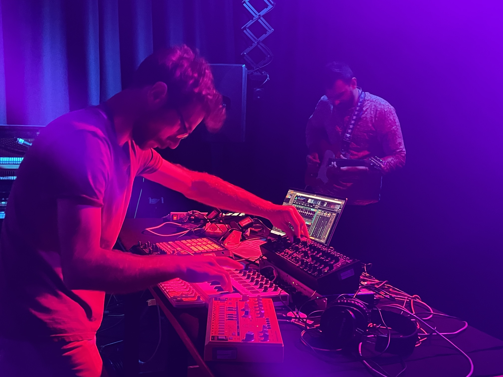
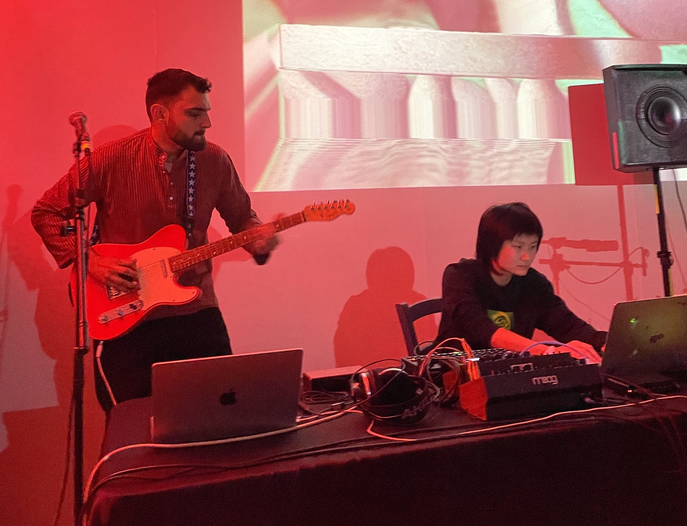
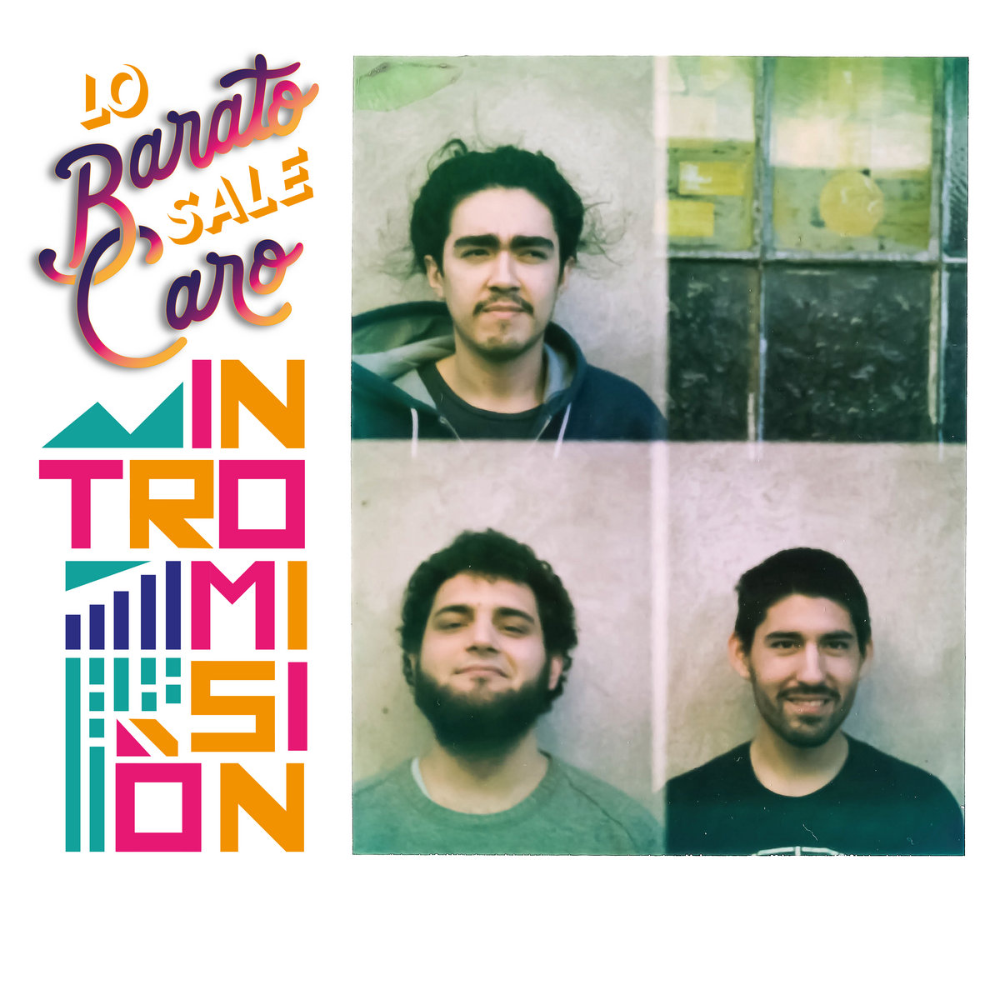
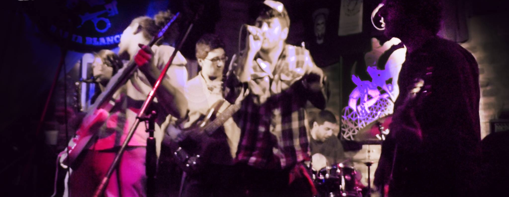

<h2>Collaborations</h2>

Lately, I had the pleasure of collaborating with talented artists and practitioners in artistic installations, the development of music interfaces and live performances and compositions.

  

    

      <iframe class="media-frame" src="https://www.youtube.com/embed/mawEpKLz_yc" title="There is an image by Paul Klee, or, Recursivity and Simultaneity by Ziyi Tao" allow="accelerometer; autoplay; clipboard-write; encrypted-media; gyroscope; picture-in-picture" allowfullscreen loading="lazy"></iframe>
    

    

      <h3>“There is an image by Paul Klee,” or, Recursivity and Simultaneity</h3>
      
Composition by Ziyi Tao · String quartet, Minifusion and live electronics · 2026

      

        The String Quartet live audio is transformed by Minifusion and live electronics. Played at Juilliard (Future Stages Festival, March 2026), and at Evangelische Stadtkirche, Offenbach am Main (July 2026).
      

    

  

  

    

      
    

    

      <h3>Live at AES AIMLA 2025</h3>
      
With Anthony Charretier · Guitar, Minifusion · 2025

      

        Playing guitar and Minifusion live with Anthony Charretier at AES AIMLA 2025.
      

    

  

  

    

      <iframe class="media-frame" src="https://drive.google.com/file/d/1brRtsk8D0CLjKIwmuWiiQCg3YcUMMYJb/preview" title="Nicola Privato with the Stacco instrument" allow="autoplay" loading="lazy"></iframe>
    

    

      <h3>Stacco and Minifusion</h3>
      
With Nicola Privato · 2025

      

        Artist Nicola Privato with his Stacco Instrument that conditions Minifusion's latent space.
      

    

  

  

    

      
    

    

      <h3>Mode Collapse</h3>
      
With Xiaowan Yi · Live at Iklectic (London) · 2023 · <a href="https://drive.google.com/file/d/10bhdxu8KEbWc6AKpZGq_cEj2XIwzOxY5/view?usp=sharing">Watch</a>

      

        In Mode Collapse we explored with Xiaowan Yi the use of Deep Learning algorithms for sound generation in live electronic music performances, combining different styles within a techno narrative.
      

      <blockquote>
        Pain and pleasure are the different sides of the same coin. Arm-wrestling sensations that crush our mind towards the primal. As said by Marvin Minsky “Too much suffering diminishes us by restricting the complexities that constitute our very selves. It must be the same for pleasure as well.”
        Artificial brains seem to suffer from similar problems. They can lock into repeating themselves in order to sustain the presence of a reward signal. If we build machines in our likeness, how can we learn to think differently?
      </blockquote>
    

  

<h2>Bands in Argentina</h2>

  

    

      <iframe class="media-frame" src="https://www.youtube.com/embed/x-Zkgu6Rqc4" title="Lo Barato Sale Caro" allow="accelerometer; autoplay; clipboard-write; encrypted-media; gyroscope; picture-in-picture" allowfullscreen loading="lazy"></iframe>
      
    

    

      <h3>Lo Barato Sale Caro</h3>
      
Vocals, guitar, synthesizer · <a href="https://lobaratosalecaro.bandcamp.com/releases">EP 2017 on Bandcamp</a>

      

        Back in Argentina, Lo Barato Sale Caro was my primary music project. A flexible funk power-trio of friends that generally incorporated guest musicians in the gigs, I had the best of times playing with them. While being the main vocalist and composer, I played the guitar or the synthesizer depending on the song.
      

      

        The flexibility of the band allowed me to explore different genres within it, such as blues, funk, Classic R&amp;B and West Coast. In 2017 we issued our first and only EP comprising five original songs.
      

    

  

  

    

      <iframe class="media-frame" src="https://www.youtube.com/embed/vmLkvHtOVXM" title="Eclécticos" allow="accelerometer; autoplay; clipboard-write; encrypted-media; gyroscope; picture-in-picture" allowfullscreen loading="lazy"></iframe>
      <iframe class="media-frame" src="https://www.youtube.com/embed/qzH1wcTUehE" title="Eclécticos" allow="accelerometer; autoplay; clipboard-write; encrypted-media; gyroscope; picture-in-picture" allowfullscreen loading="lazy"></iframe>
    

    

      <h3>Eclécticos</h3>
      
Keyboards, synthesizer, Rhodes piano

      

        Eclécticos was a pop band with original songs and many popular covers. I played as a regular drop-in keyboardist when time allowed me. The composer, guitarist and friend Pablo Benedetti invited me to record synthesizer and Rhodes piano in two of their songs.
      

    

  

  

    

      <iframe class="media-frame" src="https://www.youtube.com/embed/V1zqI1AoGNk" title="Novansamba Duo" allow="accelerometer; autoplay; clipboard-write; encrypted-media; gyroscope; picture-in-picture" allowfullscreen loading="lazy"></iframe>
      <iframe class="media-frame" src="https://www.youtube.com/embed/AqfVADBYZIQ" title="Novansamba Duo" allow="accelerometer; autoplay; clipboard-write; encrypted-media; gyroscope; picture-in-picture" allowfullscreen loading="lazy"></iframe>
    

    

      <h3>Novansamba Duo</h3>
      
Guitar, piano

      

        With Novansamba I explored the enchanting sound of Bossa-Nova. An excellent middle step for learning jazz harmony while keeping things not so complicated. While playing in this duo I learned many interesting harmonic and rhythmic techniques in guitar playing. I also jumped to the piano from time to time.
      

    

  

  

    

      <iframe class="media-frame" src="https://www.youtube.com/embed/FpYQ8I3-nLk" title="Raices de limon" allow="accelerometer; autoplay; clipboard-write; encrypted-media; gyroscope; picture-in-picture" allowfullscreen loading="lazy"></iframe>
      
    

    

      <h3>Raices de limon</h3>
      
Lead electric guitar

      

        In this beautiful family of reggae and ska I explored my <code>rockiest</code> side playing lead electric guitar.
      

    

  

  

    

      <iframe class="media-frame" src="https://www.youtube.com/embed/xnsj6AjDX1g" title="Wayron" allow="accelerometer; autoplay; clipboard-write; encrypted-media; gyroscope; picture-in-picture" allowfullscreen loading="lazy"></iframe>
    

    

      <h3>Wayron</h3>
      
Synthesizer

      

        One of the first groups I took part with, I played synthesizer while doing 80's covers.
      

    

  

