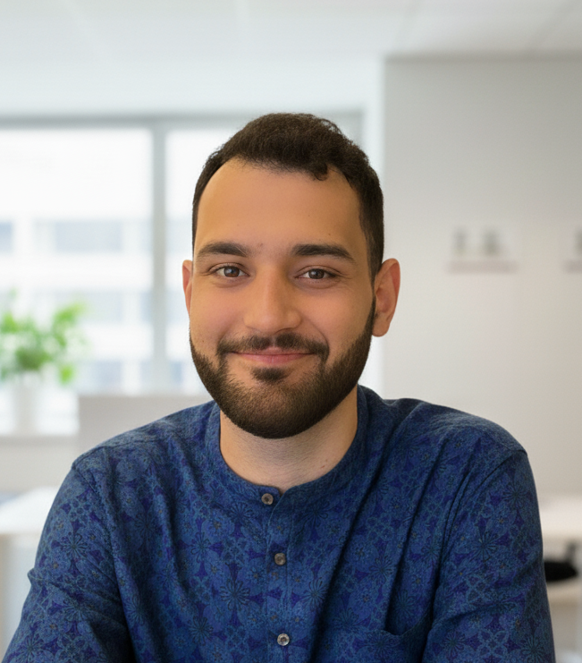

    
 
        

            
        

        

            

                I am an applied AI researcher on generative audio, a musician, and maker.
                I hold a PhD from the <a href="https://c4dm.eecs.qmul.ac.uk/">Centre for Digital Music</a> (<a href="https://qmro.qmul.ac.uk/items/0e0c5108-151c-4e0a-9e2b-569ebcaf0c82">thesis</a>). I am currently taking a short detour from AI research, working in an Innovate UK ICURe grant for market exploration until December 2026.
            

            

                I have 6+ years of experience building real-time generative models for voice and musical instrument synthesis. My work spans neural audio architectures for timbre transfer of vocals and instruments, bespoke low-latency streaming codecs adapted for live use, flow-based generative architectures, and real-time embedded deployment. I can take a project from concept and training code in PyTorch to a C++/JUCE product, and evaluate it with listening tests, user interviews and thematic analysis.
            

            

                I also have an MSc in <a href="http://ipcv.eu/">Image Processing and Computer Vision</a> and an Electronic Engineer degree from UTN-FRBB (Argentina). I have interned at Yamaha (real-time vocal synthesis and transformation) and <a href="https://www.mpi-sws.org/">MPI-SWS</a> (Efficient DNN classifiers on FPGA). Outside research, I play guitar and keys, and sing.
            

        

    

<h2>Latest News</h2>

  <table class="news-table">
    <thead>
      <tr>
        <th style="width: 20%;">Date</th>
        <th style="width: 80%;">Update</th>
      </tr>
    </thead>
    <tbody>
      <tr>
        <td>30th Sep 2026</td>
        <td>
          I have just been awarded my PhD degree! My thesis, <a href="https://qmro.qmul.ac.uk/items/0e0c5108-151c-4e0a-9e2b-569ebcaf0c82">Critical Design of Neural Audio Synthesizers for Live Musical Performance</a>, is now available online.
        </td>
      </tr>
      <tr>
        <td>1st Jul 2026</td>
        <td>
          Accepted to <a href="https://iuk-business-connect.org.uk/opportunities/icure-explore/">ICURe Explore</a> (September to December 2026), with up to £35k in funding for our project <a href="https://minifusion.live">Minifusion</a>.
        </td>
      </tr>
      <tr>
        <td>4th-6th April 2026</td>
        <td>
          Working with pianist and composer Hongbo Tsai on a <a href='https://www.instagram.com/p/DW8tji4CgBx/sound-based'> sound-based interactive installation</a>.
        </td>
      </tr>
      <tr>
        <td>31st March 2026</td>
        <td>
          Demoing Minifusion at Berklee College of Music in Boston, MA!
        </td>
      </tr>
      <tr>
        <td>26th-27th March 2026</td>
        <td>
          We are presenting in New York at the <a href='https://www.juilliard.edu/sites/default/files/3.26_future_stages_1.pdf'>Future Stages Festival</a> a composition by Ziyi Tao for string quartet and live Minifusion timbre transfer.
        </td>
      </tr>
      <tr>
        <td>11th Nov 2025</td>
        <td>
          Presenting a new talk at <a href="https://audio.dev/conference/"> ADC 2025</a>, <a href="https://www.youtube.com/watch?v=aGYPFjibwaY">Engineering Practices Break Music Interaction</a>, where I share the main takeaways of my PhD journey designing AI systems for low-latency musical interaction.
        </td>
      </tr>
      <tr>
        <td>23rd Oct 2025</td>
        <td>
          Presenting our paper in <a href="/brave"> Low-Latency Neural Synthesizers </a> at the <a href="https://aesshow2025lb.sched.com/event/28veP/designing-neural-synthesizers-for-low-latency-interaction"> AES Show</a> in Long Beach, California.
        </td>
      </tr>
      <tr>
        <td>13th Oct 2025</td>
        <td>
          In-person demoing of <a href="https://minifusion.live"> Minifusion: Live Instrument Transformation</a> at <a href="https://waspaa.com/technical-program-schedule/"> WASPAA</a> in Lake Tahoe, California, USA.
        </td>
      </tr>
      <tr>
        <td>10th Oct 2025</td>
        <td>
          I am giving a talk on Neural Audio Synthesis for Low-Latency Interaction at the 
          <a href="https://www.cirmmt.org/en/events/workshops/research/10-oct-2025-generative-audio-music-making"> CIRMMT's GAMMa Workshop</a>
        </td>
      </tr>
      <tr>
        <td>25th Sep 2025</td>
        <td>
          Streaming online our <a href="/workshop/rt_neural_audio/"> tutorial on Real-time Neural Audio Inference and Design</a> with Jatin Chowdhury!
        </td>
      </tr>
      <tr>
        <td>8th Sep 2025</td>
        <td>
          Giving a Tutorial on Real-time Neural Audio Inference and Design with Jatin Chowdhury at the first AES conference in AI and ML for Audio 
          (<a href="https://aes2.org/events-calendar/2025-aes-international-conference-on-artificial-intelligence-and-machine-learning-for-audio/">AIMLA</a>) in London.
        </td>
      </tr>
      <tr>
        <td>24th Jun 2025</td>
        <td>
          I am presenting my <a href="https://instrumentslab.org/data/andrew/caspe_nime2025.pdf">paper and demo</a> on Waveform Autoencoding for Instrumental Interaction at NIME 25 in Australia
        </td>
      </tr>
      <tr>
        <td>12–14th Jun 2025</td>
        <td>
          Showcasing the <a href="https://fcaspe.github.io/BravePlugin">BRAVE Plugin</a> at <a href="https://sonar.es/">Sonar 2025</a> in Barcelona!
        </td>
      </tr>
      <tr>
        <td>May 2025</td>
        <td>
          Excited to go for a month placement in Iceland, at the <a href="https://iil.is/">Intelligent Instruments Lab</a>!  
          Check out this <a href="#">Collaboration</a> we did with Nicola Privato combining the 
          <a href="https://fcaspe.github.io/brave">BRAVE</a> model and his great 
          <a href="https://nicolaprivato.com/stacco">Stacco</a> Instrument.
        </td>
      </tr>
      <tr>
        <td>11th Apr 2025</td>
        <td>
          Our paper <a href="https://fcaspe.github.io/brave/">Designing Neural Synthesizers for Low-Latency Interaction</a> has been published in the May 2025 Issue of JAES.
        </td>
      </tr>
    </tbody>
  </table>

